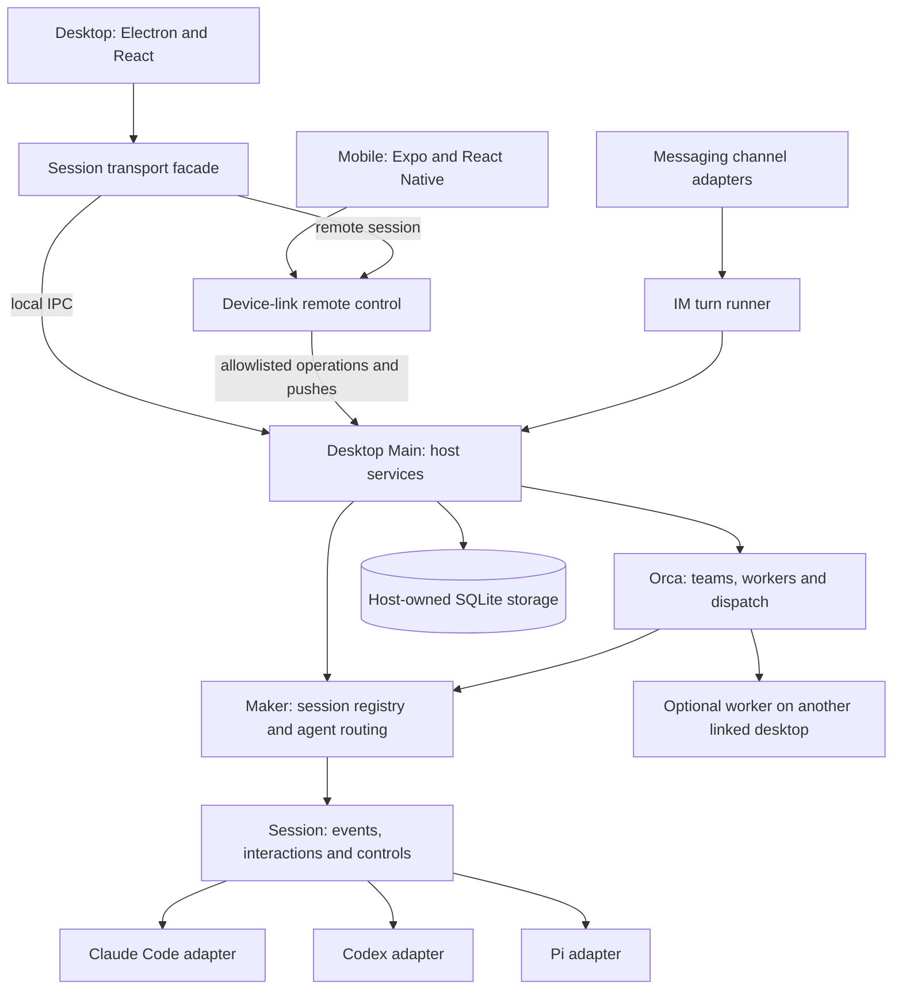
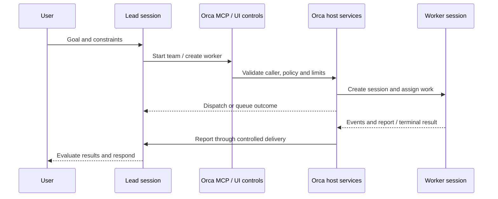

# Cindy: agents, sessions and interfaces

Source inspection: 2026-10-29. Upstream: `makecindy/cindy`, commit
`727afb1ad6902176e2ec55254154b900c489a998`.

This is an architecture study, not an implementation proposal or a runtime
acceptance report. The public source was inspected without installing
dependencies, launching Cindy, connecting accounts or running upstream tests.
Upstream file references below are relative to that exact source revision.
Repository identifiers and file paths are used instead of external runtime URLs.

The key pattern is that **the product owns the session, while an agent engine
executes its turns**. Cindy combines this with explicit engine capabilities,
normalized events, a host-controlled collaboration layer and interfaces that
route operations to the device owning the task.

The [architecture follow-up](session-task-architecture-review.md) maps these
patterns to Ningo's existing domains, task runner and provider ports. It gives
lifecycle/dispatch/settlement contracts priority over their UI projection and
removes the earlier UI prerequisite from delegation planning.

## 1. Architecture map

This diagram emphasizes control boundaries; it is not a complete network or
deployment diagram. Authentication, relay services, provider gateways and cloud
companions introduce additional paths. The backend service is explicitly outside
the public monorepo, so this checkout cannot establish its internal architecture.

| Area | Source entry points | Responsibility observed |
| --- | --- | --- |
| Agent runtime abstraction | `packages/maker-core/src/agents/base-agent.ts` | `BaseAgent`, `AgentSessionHandle`, startup, sending, event stream and engine-specific extensions |
| Session registry | `packages/maker-core/src/maker.ts` | Route by agent kind, create/restore sessions, inject host dependencies and lifecycle hooks |
| Session controls | `packages/maker-core/src/session.ts` | Forward events, expose capabilities, resolve interactions and guard turn lifecycle |
| Shared contracts | `packages/maker-core/src/types/events.ts`, `types/capabilities.ts` | Normalize engine output and explicitly describe supported operations |
| Desktop host | `apps/desktop/src/main/maker-host/`, `main/maker-ipc/` | Provision engines, persistence, provider routing, input coordination and host-side controls |
| Collaboration | `main/maker-ipc/orcaLifecycleService.ts`, `orcaWorkerCreationService.ts`, `orcaTeamService.ts` | Team activation, worker creation, assignment, reporting and release |
| Agent-facing team tools | `packages/lizi-mcps/src/orca/server.ts`, `packages/orca-workflow/src/orca-bridge-mcp.ts` | Lead control tools and worker-to-lead bridge |
| Desktop remote access | `apps/desktop/src/renderer/lib/makerTransport.ts` | Select local IPC or remote device-link by session ownership |
| Mobile remote access | `apps/mobile/src/device-link/mobileMakerTransport.ts` | Operate desktop-owned sessions through shared remote channels |
| Messaging entry | `apps/desktop/src/main/im/shared/turnRunner.ts` | Map channel input to a session turn and render events/interactions back to that channel |
| Structured answers | `packages/maker-shared/src/richAnswer.ts` | Declarative output document consumed by separate desktop/mobile renderers |

Paths abbreviated as `main/...` in this table are under `apps/desktop/src/`.

## 2. How different agents fit the same product

### Separate product identity from native runtime identity

`SessionMeta` in `packages/maker-core/src/interfaces/session-storage.ts` separates
the product session `id` from the engine's `sdkSessionId`. It also records agent,
model, working directory and location metadata. Storage is a host-injected
interface, rather than a UI-owned object.

The file explicitly distinguishes transient execution state from persistent
product state. A stopped or closed native process must not silently turn an
active product conversation into an archived one. This separation allows the
interface to keep showing the task while its engine is stopped or reconstructed.

Switching engines does not make their internal contexts identical.
`apps/desktop/src/main/maker-ipc/agentHandoff.ts` builds bounded handoffs from
persisted history, with recent verbatim turns, older extracts, tool-result context
and retrieval guidance. The code distinguishes full handoff from delta handoff
when returning to a parked native session. Displayed user text and engine-bound
handoff text are separate projections.

### Normalize events, retain capability differences

Each adapter translates engine output to `AgentEvent`. The shared vocabulary
includes text, tool starts/results, task updates, interactions, usage, status,
context-compaction boundaries, completion and errors. Consumers can render the
same broad lifecycle without parsing each engine's native protocol.

The abstraction does not promise identical functionality. `Capabilities` covers
model switching, effort, permissions, plan mode, attachments, fork, rewind,
interruption and same-turn steering. Unsupported operations distinguish
`sdk-missing`, `not-implemented` and `platform-limited`.

Two details are particularly useful:

1. Cancellation support does not imply support for inserting input into an
   active turn; `sameTurnSteer` is separate.
2. An error event does not necessarily mean execution stopped. `isTerminal` and
   `willRetry` preserve that distinction for consumers.

Evidence: the three `agents/{claude-code,codex,pi}/index.ts` adapters and their
translators, plus `types/events.ts` and `types/capabilities.ts`.

## 3. How Orca coordinates a team

An Orca worker is a complete session with its own engine, model, history and
interaction stream. It can be inspected and operated through the session UI.
This is distinct from native engine subagents, which are also represented through
`agent_task_update` events. The two mechanisms should not be conflated.

### Durable relationships and distinct lifecycle owners

`apps/desktop/src/main/localDb/schema.ts` contains:

| Record | Meaning |
| --- | --- |
| `sessions.orca_role` | Lead or worker role |
| `orca_teams` | Team linked to one lead; partial unique index permits at most one active team per lead |
| `orca_workers` | Worker/session link, role, label, status, focus and optional remote execution metadata |
| `sessions.parent_session_id` | Fork provenance, separate from team membership |

Worker states are `idle`, `running`, `done` and `error`. Team states are separate:
`active`, `completed`, `cancelled` and `failed`. Database constraints also enforce
team-local labels and at most one focused worker per team.

Creation, team activation and existing-worker control have separate services.
`orcaInterAgentDispatcher.ts` handles delivery through a narrow dependency
interface. Assignment outcomes distinguish direct dispatch, queueing and steering;
queued messages have an addressable ID and can be managed afterward.

The team service coordinates assignment acceptance, rollback and terminal
reporting. Its auto-bridge captures worker output and can deliver a report when
the worker terminates. Runtime/turn identities prevent late results from settling
a newer assignment. Explicit reports and automatic reports share settlement
logic to avoid duplicated obligations. These are implemented safeguards, not a
proof of exactly-once execution across every failure mode.

### Agent tools and UI controls share host authority

The `cindy_orca` MCP server exposes team controls such as starting a team,
creating workers, sending tasks, managing queued messages and ending a team.
Worker-side bridge tools include reporting to the lead and reading lead history.
Host services receive the actual caller/session context and enforce authority;
tool visibility alone is not permission.

The source comment in `packages/lizi-mcps/src/orca/server.ts` explains an
interesting discovery tradeoff: core collaboration tools are directly exposed
instead of hidden behind a generic tool-discovery operation. This spends prompt
space to make delegation more reliably discoverable.

### Remote workers are implemented in the inspected revision

`orcaRemoteWorkers.ts` probes eligible linked desktops, creates a real remote
task and stores a local proxy session. Dispatch and liveness operations run on
the execution device; the lead host retains team accounting and report handling.
`orcaRemoteWorker.ts` defines the cross-device control contract.

The schema stores `execution_device_id`, `remote_session_id`, pending reports,
the last bridged message ID and remote-release state. This supports recovery and
report deduplication beyond an in-memory connection.

Three locations must therefore be distinguished: the computer displaying the
interface, the computer owning/executing the task, and the computer running the
agent. `agentDeviceId` and `executionDeviceId` represent different decisions.
SSH execution is another transport path and should not be treated as identical
to linked-device remote control.

## 4. How the interfaces remain coherent

### Desktop and mobile share contracts, not one component tree

`makerTransport.ts` resolves session ownership and selects local IPC or remote
device-link operations. Its stated goal is to reuse desktop stores, reducers and
UI for remote sessions. Mobile has a separate transport facade and native UI
using the same host channels.

`packages/device-link/src/allowlist.ts` is a default-deny remote control surface.
It separates remote-safe task operations from local window actions, dialogs and
sensitive host operations. Unsupported old-host channels remain a compatibility
case rather than an invitation to execute the operation locally.

This is more than syncing chat text: the interface can operate a session's queue,
pending decisions, controls and history on its owning computer. That does not
imply whole-disk replication or native agent execution on the phone.

### Team views reuse ordinary session views

The current desktop layout is the ordinary lead conversation plus a collaboration
sidebar. `OrcaWorkerPanel.tsx` manages worker selection/creation and embeds the
session view, with a distinct pane for workers executing on another device.
`OrcaSplitView.tsx` now serves the document chat rail's lead/worker toggle.
`OrcaWorkflowRoute.tsx` preserves old collaboration links by redirecting them
to the ordinary lead route with sidebar state.

This reuse follows from the worker being a session. Worker execution status,
report delivery and whether the user has actually viewed the worker remain
different concerns; the panel explicitly avoids treating a hidden pane as viewed.

### Messaging is another turn adapter

`im/shared/turnRunner.ts` finds or creates the channel session, ensures its live
Maker session, observes events and interactions, and sends results through the
channel's presentation/transport facilities. It handles queueing when another
turn is running rather than starting an independent engine loop per message.

`docs/dev-rules/im-turn-flow.md` describes personal IM and official hook paths
as an ongoing convergence. They should not be described as a completely unified
implementation today. Inspection here establishes the shared turn-runner pattern,
not behavioral parity across every messaging platform.

### Answers can carry a shared declarative interface

`packages/maker-shared/src/richAnswer.ts` defines explicit `cindy-ui` fenced
content with bounded nodes, component kinds and document depth. It describes
text, charts, layout, media, forms and controls without evaluating arbitrary code.

Desktop's `renderer/components/chat/RichAnswer.tsx` and mobile's
`src/session/RichAnswer.tsx` consume the shared parser and interaction helpers
but render platform-specific components. A send action returns text through the
normal session input path, with submission state guarding duplicate clicks.
This is a particularly transferable pattern for interactive agent responses.
Other HTML/MCP-app surfaces exist; this finding does not characterize all of
them as using the declarative renderer.

## 5. What transfers to Ningo Dokja

These are design inferences from the inspected source, not approved changes.
Our mandatory path remains `Interface → Event/Request → Orchestrator → Domain
→ Service`. Cindy places substantial product coordination in Electron Main;
copying that placement into our desktop would create a competing owner.

| Cindy pattern | Possible Ningo application | Ownership constraint |
| --- | --- | --- |
| Product session above native engine | Keep task identity, history and outcomes stable across runtime changes | Domain defines lifecycle policy; orchestrator sequences; service adapts runtime |
| Common events plus capabilities | Render progress, tools, questions and unsupported controls consistently | Internal typed contract first; preserve the public envelope and existing replies |
| Full worker sessions | Inspect delegated work and address follow-up input to a specific task | Domain owns delegation/acceptance rules; orchestrator owns cross-task sequencing |
| Explicit queue/delivery outcomes | Show accepted, queued, running and completed states honestly | Orchestrator controls dispatch; domain evaluates task completion |
| Shared host controls for UI and MCP | Human and agent operations use the same validated application actions | Both enter orchestration; interfaces never bypass domains to invoke services |
| Transport by session ownership | Additional operator interfaces can control existing tasks | Interface adapter preserves ownership and authorization through ingress |
| Declarative rich answers | Native desktop controls and plain-text channel projections of the same answer | Presentation at interfaces; resulting actions return through existing ingress |
| Terminal identity and report settlement | Reject stale completion and avoid reporting a newer assignment as done | Workflow correlation and durable outcomes require an explicit design |

Existing Ningo anchors inspected for this comparison:

- [Capability map](capability-map.md): responsibilities and extension path.
- [Desktop transport](../dokja_interfaces/desktop/src/main/orchestrator_client.ts):
  bounded concurrent requests using the existing envelope.
- [Desktop chat stream](../dokja_interfaces/desktop/src/main/chat_stream.ts):
  provisional previews followed by an authoritative reply, with conservative fallback.
- [Private inference handler](../dokja_orch/runtime/chat.go): bounded chat input,
  streaming and final inference results; not an equivalent of Cindy's entire
  tool-using agent session contract.

A useful evaluation order would be session identity and lifecycle, capabilities
and progress events, delegated tasks with report settlement, and then richer
interface controls. Remote execution can be evaluated after those contracts are
clear. This order is a recommendation, not a roadmap change; no event, route,
schema, runtime, dependency or compose contract was modified by this study.

## 6. Evidence limits and reading guide

Two discrepancies demonstrate why source should lead this map:

1. The Orca architecture document describes a broad split layout, but current
   `OrcaWorkerPanel.tsx`, `OrcaSplitView.tsx` and `OrcaWorkflowRoute.tsx` establish
   the sidebar layout and compatibility route described above.
2. Older current-boundary prose describes the team as remaining on the controlled
   host; the inspected revision also contains explicit cross-device worker
   services, protocol and durable schema fields.

For a focused source walkthrough, read in this order:

1. `packages/maker-core/src/interfaces/session-storage.ts`,
   `agents/base-agent.ts`, `types/events.ts`, `types/capabilities.ts`.
2. `packages/maker-core/src/maker.ts`, `session.ts` and one adapter/translator.
3. Desktop `main/maker-ipc/orcaLifecycleService.ts`,
   `orcaWorkerCreationService.ts`, `orcaTeamService.ts`,
   `orcaInterAgentDispatcher.ts`, then `main/localDb/schema.ts`.
4. `packages/lizi-mcps/src/orca/server.ts` and
   `packages/orca-workflow/src/orca-bridge-mcp.ts`.
5. Desktop `renderer/lib/makerTransport.ts`,
   `features/cc-agent/OrcaWorkerPanel.tsx`, mobile
   `src/device-link/mobileMakerTransport.ts`, and device-link `src/allowlist.ts`.
6. Shared `richAnswer.ts` and both platform renderers; remote-worker services
   when studying recovery across devices.

Relevant upstream regression suites were located, including
`orcaInterAgentDispatcher.test.ts`, `makerTransportOrcaRouting.test.ts`,
device-link `orcaRemoteWorker.test.ts` and shared `richAnswer.test.ts`.
Their presence indicates intended verification points; none was executed in this
study. Cloud-backend behavior, actual cross-device recovery, model quality,
performance and full platform parity remain unverified.
