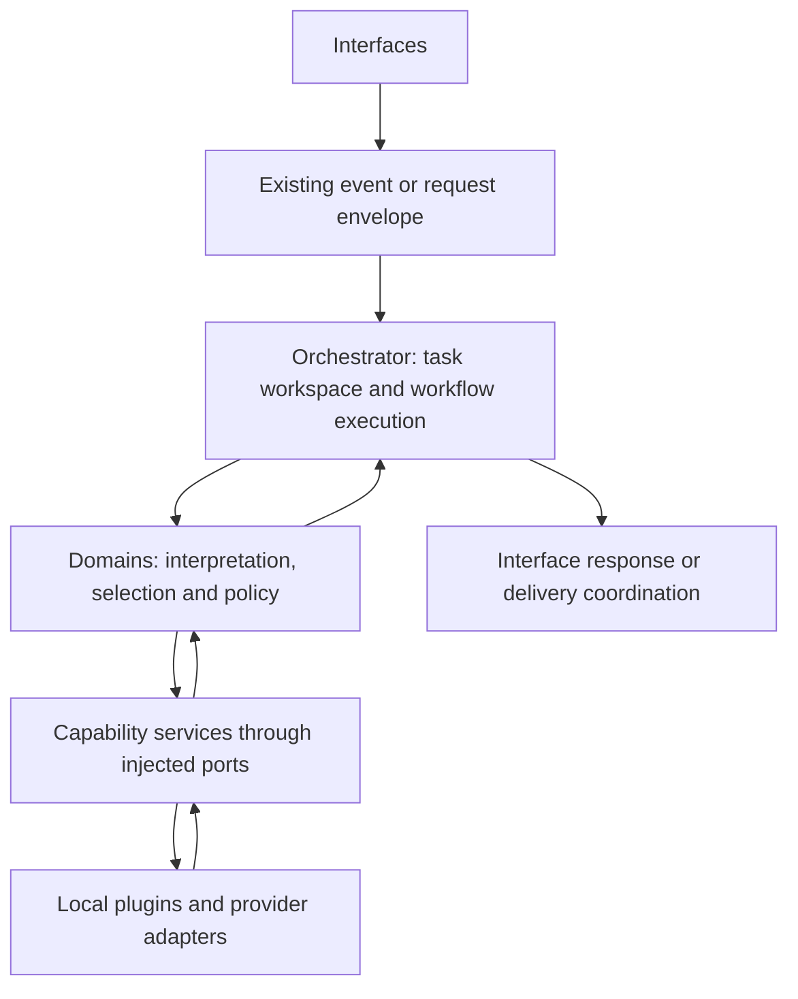

# Research: cognitive macro-components and plugins

Follow-up: [Knowledge–Prediction–Experience feedback graph](./knowledge-prediction-experience-research.md).
Book/source ownership is decided in ADR 0006: reading is one macro-component,
and Book is not a service. ADR 0007 generalizes it: macro-components are
faculties, and product features (Book, Meme, Digest) are workflows over them. The general-knowledge/contextual-experience allocation
remains under research in ADR 0005, which examines reciprocal dependencies and
bounded cycles that the initial macro map did not resolve.

Date: 2026-10-18. Status: research proposal, not an accepted architecture decision.

This research examines Dokja as a system of large, extensible capabilities inspired
by cognitive architecture and neuroscience. The recommendation is to develop
**macro-components with local plugin hosts, coordinated through a bounded task
workspace and explicit domain decisions**.

The evidence comes from the current working tree, based on commit `dd0efd4`, and
primary research papers and official engineering documentation. `.planning` was
excluded as an architectural authority. Existing documentation was used as a guide
and checked against representative implementation paths. This is a targeted source
review, not a complete audit or runtime validation. Uncommitted experiments are
identified separately.

## 1. What the repository already supports

| Capability | Implementation evidence | Architectural implication |
| --- | --- | --- |
| Source acquisition | [Feeds discovery](../dokja_services/dokja_feeds/feeds/manifest.go), [runner](../dokja_services/dokja_feeds/feeds/runner.go), and [service](../dokja_services/dokja_feeds/feeds/service.go) | A reusable host discovers manifests without executing them, runs enabled plugins independently, bounds execution and output, and retains the last successful result in memory. |
| Knowledge | [Plugin loader](../dokja_services/dokja_knowledge/plugins.py), [extractor registry](../dokja_services/dokja_knowledge/extractors/__init__.py), and [service](../dokja_services/dokja_knowledge/service.py) | Generic ingestion and retrieval mechanisms are extended by source and format plugins. Knowledge already serves research documents and explicitly labelled meme examples. |
| Experience memory | [Memory service](../dokja_services/dokja_memory/memory/service.go) and [store](../dokja_services/dokja_memory/memory/store.go) | Experiences, outcomes, and similarity have their own storage boundary. This is distinct from document knowledge. |
| Prediction and evaluation | [Memory domain](../dokja_domain/dokja_memory/domain.go) and [prediction/scoring](../dokja_domain/dokja_memory/predict.go) | Acceptance estimates, insufficient-evidence behavior, and Brier comparison with a baseline already exist as domain rules. |
| Selection policy | [Digest domain](../dokja_domain/dokja_digest/domain.go) | The domain chooses and orders items; Feeds supplies observations. This is a useful existing separation between acquisition and attention-like selection, and the seed of the Attention faculty (ADR 0007). |
| Composed behavior | [Hashtag workflow](../dokja_orch/internal/handlers/meme_hashtag_workflow.go) and [experience integration](../dokja_orch/internal/handlers/hashtag_experience.go) | OCR, labelled knowledge, suggestions, prediction, and later feedback already participate in one feature. |
| Task context | [Chat sessions](../dokja_orch/internal/handlers/chat_session_manager.go) and [dispatcher](../dokja_orch/internal/core/dispatcher.go) | Conversation history exists, but there is no general typed task workspace in these paths. The dispatcher executes steps without using successful result values to select the next step. |

These are meaningful foundations for the user's proposed direction. A component
can provide a broad, stable function while plugins supply particular sources,
formats, providers, or strategies.

An additional local experiment, `dokja_services/dokja_prediction`, is currently
untracked. Its Rust crate contains SQLite document ingestion, keyword recall, and
a prediction placeholder whose confidence increases with the number of recalled
documents. Its README explicitly describes a scaffold without an HTTP server.
The inspected orchestrator wiring and lite/production compose files do not wire
it as a runtime prediction service. Its intended scope overlaps Knowledge and
Memory and should be reconciled before adoption. Its confidence calculation is
not evidence of calibrated prediction. This research did not build the crate.

## 2. Scientific ideas worth translating

The following mappings are engineering proposals. The cited papers support the
underlying models or observations; they do not validate Dokja's implementation.

| Research | What it supports | Proposed translation | Limit of the analogy |
| --- | --- | --- | --- |
| Common Model of Cognition [S1] | A functional architecture with perception, action, working memory, declarative memory, procedural memory, and a cognitive cycle; modules may have internal subdivisions. | Define stable capability boundaries and an explicit cycle that coordinates their results. | A reference framework from cognitive architecture, not a complete or universally settled map of the human brain. |
| Global neuronal workspace [S2] | A computational model combining specialized processors with distributed workspace activity that coordinates selected information during effortful tasks. | Maintain selected task evidence and proposals in a shared workspace, accessed through orchestration. | A software workspace is an engineering abstraction. It does not establish consciousness or anatomical equivalence. |
| Complementary learning systems [S3] | A model explaining complementary rapid acquisition and gradual integration of experience. | Separate recording an episode from promoting a repeatedly supported conclusion or procedure. | Copying records between databases does not reproduce hippocampal or cortical learning. |
| Prediction and reward [S4] | A link between reward prediction errors, dopaminergic activity, and learning models. | Record a prediction before observing an outcome; evaluate errors against a baseline. | User acceptance is a task-specific label, not a universal reward, truth measure, or model of dopamine. |
| Predictive coding [S5] | A visual-processing model in which higher-level predictions and lower-level residual errors interact. | Represent expected and observed results separately and use discrepancies to request more evidence. | This is distinct from predicting whether a user will accept a suggestion. The cited model does not establish a general assistant architecture. |
| Metacognition extension [S6] | A proposal to extend the Common Model with monitoring and control of cognitive processing. | Track evidence sufficiency, execution cost, failures, and stopping conditions. | The consulted version is a 2025 preprint proposal; performance benefits require local evaluation. |

The 2025 adversarial experiment comparing global neuronal workspace and integrated
information theories challenged predictions of both [S7]. It strengthens the case
for treating neuroscience-inspired architecture as testable design hypotheses.
Dokja should be evaluated on observable behavior, reliability, and extensibility.

Use functional names such as `working_memory`, `attention`, `prediction`, and
`action_selection` in design discussions. Assign software boundaries according to
contracts, state ownership, and failure behavior. Anatomical names would require
stronger claims than this research supports.

## 3. Proposed macro-component map

A macro-component is a **capability boundary**, potentially spanning a domain,
its ports, one or more service implementations, and local plugin contracts. Its
deployment can remain independent where dependencies or operating requirements
justify that. The conceptual map does not prescribe one container per row.

| Functional responsibility | Starting point in Dokja | Extensions | Owner of decisions |
| --- | --- | --- | --- |
| Reading (acquisition and perception) | Feeds host; Book and Knowledge extraction, meme scrapers/OCR/attachments and voice input migrate into it | Source, format, OCR, transcription adapters, run on a schedule or on demand | Relevant domains decide what observations mean and when to use them. |
| Semantic knowledge | Knowledge | Retrieval and indexing implementations; fetchers and formats move to Reading (ADR 0006) | Knowledge domain owns the document contract and retrieval semantics. |
| Episodic memory | Memory | Storage, embedding, recall implementations | Memory domain owns experience and outcome semantics. |
| Prediction | Memory prediction/scoring | Predictors with explicit targets and evaluators | Domain owns the target, evidence requirements, and permitted use. |
| Moderation | Moderation domain, meme screening | Safety and content classifiers, platform rules | Decides admissibility: allow, reject, review, or constraints. |
| Attention | Digest ranking, hashtag relevance threshold | Ranking and scoring strategies | Decides priority: score, rank, select; never overrides moderation. |
| Language generation | Chat domain/handler and Chat AI | Model providers and structured-output adapters | Chat owns conversation and response policy. |
| Action and communication | Communications, media delivery, voice output | Platform and output adapters | Communications authorizes and executes actions; receipts go to Experience. |
| Coordination and working memory | Orchestrator core | Typed Go workflows, later versioned recipes (ADR 0007) | Orchestrator sequences work; domains supply business decisions. |

Product features are not macro-components
([ADR 0007](./decisions/0007-faculties-not-features.md)). Book, Meme and Digest
are workflows that run the cycle across these faculties, plus the policy
parameters for their case. Reading a book is a reading, Knowledge stores the
result with provenance, and Experience records that it was a book and how it was
used ([ADR 0006](./decisions/0006-reading-macro-component.md)). Meme is scheduled
reading, screening, labelled knowledge, delivery and feedback; Digest is a
selection policy over what Feeds read.

This research first proposed keeping acquisition modality-specific until two real
consumers needed the same contract and lifecycle. That condition is met: Feeds
and Book/Knowledge file reading are separate reading paths with two plugin
protocols. The functional map is still useful before any folder moves or service
mergers.

### Relationship to the mandatory layers



Cross-capability workflows stay in the orchestrator. A Knowledge plugin does not
gain a general connection to every service or access to other domains' databases.
Policy plugins, if introduced, belong to the domain boundary. Provider plugins
belong to the corresponding service host. Workflow extensions are interpreted
by the orchestrator and invoke registered domain actions.

There is a terminology decision to resolve: the current instructions describe
services as stateless integrations, while Memory and Knowledge persist data and
Feeds retains a cache. Document the distinction between stateless request
execution, persistent repositories, rebuildable caches, and domain-owned state.
The proposed design keeps business decisions in domains. Any change to the
canonical service responsibility rule needs an explicit architecture decision;
this research does not silently redefine it.

## 4. Coordination: a bounded workspace for each task

Use a small orchestration kernel responsible for registration, invocation,
deadlines, cancellation, and workflow transitions. Keep specialized decisions in
domain modules. The workspace is a typed record owned by one task or conversation,
with authorized scope and a finite lifecycle.

Proposed internal fields:

- Task identity, triggering event, actor/channel scope, and goal.
- Observations with provenance, timestamps, and source identifiers.
- Selected evidence references and their retrieval scores.
- Proposed actions, relevant domain decisions, and explicit preconditions.
- Predictions with a named target, horizon, method version, and evidence support.
- Remaining time, step, and resource budgets.
- Execution receipts, observed outcomes, and termination reason.

Store references to large documents and media. Share only the evidence a step
needs. Initially, the orchestrator is the sole writer: domain calls return typed
results, and the orchestrator validates and incorporates them. This avoids an
uncontrolled shared mutable dictionary between plugins.

A practical cycle is:

```text
receive observation
  → domain interprets relevance and constraints
  → orchestrator requests selected evidence
  → domain proposes or chooses an action
  → orchestrator applies gates and executes the workflow
  → record observed result
  → evaluate, continue within budget, or stop
```

Parallel evidence gathering can be added behind this cycle. Side effects require
explicit ordering and durable execution receipts where replay matters. Define
whether state is volatile or checkpointed per workflow. The analogy with working
memory does not itself determine persistence requirements.

“Attention” first means a measurable selection policy: which evidence enters the
task, which work receives budget, and when an optional capability is skipped.
Digest selection is an existing example. Domain relevance and eligibility remain
domain decisions; queue fairness and deadline enforcement belong to orchestration.

“Procedural memory” can initially mean versioned, reviewed workflow recipes with
declared preconditions and outcomes. Generated text or recalled documents do not
automatically become executable procedures. Promotion of a learned recipe needs
the same validation as any other change in executable behavior.

## 5. Plugins: shared lifecycle, capability-specific contracts

Feeds and Knowledge currently have different extension mechanisms:

| Host | Current mechanism | Strength | Limitation to address |
| --- | --- | --- | --- |
| Feeds | External commands with strict JSON manifests and bounded JSON output | Language independence, independent runs, explicit enablement, previous-result retention | No plugin API version in the inspected manifest; cache is volatile; subprocesses retain operating-system access permitted to their identity. |
| Knowledge | Python imports calling `register(registry)` | Direct access to extraction libraries and a small extension API | Runs in the service process; no manifest negotiation or per-plugin execution boundary in the loader. |

A failed Knowledge import is caught and skipped, but that does not isolate a
hanging invocation or native crash. Similarly, Feeds timeouts and process groups
provide operational controls, not a complete filesystem/network sandbox.

The useful common contract is lifecycle metadata: identity, API version,
capabilities, activation, required configuration, execution limits, health, and
compatibility errors. Each capability retains a typed input/output contract.

Proposed manifest vocabulary, not accepted by today's loaders:

```json
{
  "id": "local-document-reader",
  "plugin_api": 1,
  "version": "0.1.0",
  "host": "knowledge",
  "provides": ["document.extract.v1"],
  "runtime": "subprocess",
  "enabled": false,
  "limits": {"timeout_ms": 30000, "output_bytes": 1048576}
}
```

Feeds currently rejects unknown manifest fields. Introduce a version-aware loader
and an adapter for the existing format before adopting new fields. Existing
Knowledge registration functions can likewise be supported by a legacy adapter.
Choose deterministic conflict handling when two plugins claim the same capability;
prefer an explicit configuration selection over load-order overrides.

### Execution options

| Option | Suitable use | Cost or limitation | Recommendation |
| --- | --- | --- | --- |
| In-process extension | Trusted, small transformations using existing Python libraries | Shared memory, dependencies, and failure domain | Keep where the trust and execution assumptions are explicit. |
| Subprocess with JSON or local RPC | Source adapters, polyglot tools, dependency-heavy extractors | Serialization, startup cost, operating-system permission management | Default experimental path, building on Feeds. |
| WebAssembly component | Small portable transformations needing constrained host access | Packaging effort and compatibility work for existing native/ML dependencies | Evaluate for a concrete plugin before standardizing. |
| Independently deployed service | Long-running models, GPU workers, independently scaled capabilities | Deployment and network operations | Retain for macro-components where those needs already exist. |

HashiCorp's plugin design demonstrates subprocess/RPC interfaces and protocol
versioning; its documentation explicitly limits the library to a local reliable
network [S8]. It is a design reference, not a recommendation to use its transport
between Dokja services. Wasmtime demonstrates typed component interfaces and
capability-based filesystem access [S9] [S10]. Neither requires replacing the
current Feeds protocol during this research.

A capability catalogue should initially contain configured, known bindings.
Discovery reports availability; it does not execute or install new code. An LLM
can propose a capability by identifier, while the orchestrator resolves that
identifier through an allowed domain action.

## 6. Memory, prediction, and learning boundaries

Keep four distinct concepts in the design:

| Concept | Stored content | Lifecycle |
| --- | --- | --- |
| Working memory | Current goal, selected evidence, pending action | Bounded task/session state; optionally checkpointed |
| Semantic knowledge | Documents and explicit facts with provenance | Updated, indexed, corrected, or removed through Knowledge |
| Episodic memory | An action in a context, its recorded prediction, and observed outcome | Append experience and resolve outcome through Memory |
| Procedural knowledge | Validated recipes and their versions | Review, test, activate, supersede, and roll back |

These distinctions do not require four new services. Knowledge and Memory already
provide two useful owners; the first workspace and recipe registry can live with
the orchestrator.

Define each predictor around a specific question. “Will this hashtag be accepted?”
and “Will this source fetch succeed?” need different targets and evidence.
Similarity, probability of acceptance, factual reliability, and expected task
utility must remain separate quantities. The current Rust scaffold's evidence
count cannot substitute for these definitions.

The existing Memory predictor is a useful baseline: it stores original
probabilities, measures Brier error, and reports insufficient support. Its default
thresholds are explicitly provisional. Validate calibration on later outcomes,
with time-respecting splits and a frozen prediction snapshot. Only observed
outcomes should score a prediction; missing feedback needs separate reporting.

One timing detail matters: `HashtagExperience.Suggested` starts background work
that predicts before storing the experience. This is not a guaranteed durable
prediction-before-delivery boundary, and it is not part of action selection.
An experiment that needs that guarantee must persist the prediction before
execution and link it to a specific action attempt.

For eventual consolidation, propose candidate reusable knowledge from accumulated
episodes, retain supporting references, test it against held-out cases, and promote
it through a controlled domain operation. Automatic suggestions must not become
their own ground-truth examples. The current hashtag code stores explicit labels
separately from recording predictions, which is a useful starting point.

## 7. Alternatives and recommended experiment

| Direction | Fit to the project | Main risk |
| --- | --- | --- |
| Continue adding handlers and local plugin APIs | Low initial effort; preserves current behavior | Contracts and cognitive coordination remain implicit. |
| Macro-components with local plugin hosts and a bounded workspace | Builds on Feeds, Knowledge, Memory, domains, and orchestration | Requires disciplined contracts and explicit policy ownership. |
| Independently reasoning agents negotiating all work | Potentially flexible for open-ended tasks | More nondeterminism, duplicated state, and difficult attribution of failures and learning. |

Recommend the second direction. An LLM is an implementation of some capabilities,
and selected workflows may use agentic planning. Reliable domain operations can
remain deterministic within the same architecture.

### First experiment: the existing hashtag loop

Use the current media-to-hashtag path as the first cognitive composition experiment:

```text
media observation
  → OCR evidence
  → retrieve explicit labelled examples
  → domain proposes hashtag or abstains
  → predict the defined acceptance outcome in shadow mode
  → execute the existing policy-approved action
  → record explicit later feedback
  → compare prediction with the frozen baseline
```

All cross-capability calls remain orchestrated. Shadow mode records predictions
without changing what is delivered. Use a task workspace to explain each decision
and identify the provider, evidence, policy version, and action attempt involved.

Pair this with one plugin portability experiment: host an additional local
document extractor through the proposed lifecycle adapter, while retaining the
existing extractor contract. This separately tests whether the plugin design
reduces the cost of extending a macro-component.

| Hypothesis | Measurement | Evidence needed to proceed |
| --- | --- | --- |
| Stable capability contracts reduce coupling | Files and modules changed when replacing one OCR/extractor implementation | A replacement passes the same contract tests without changing router or workflow business logic. |
| Explicit workspace improves diagnosis | Replay traces for success, abstention, unavailable retrieval, and timeout | Each terminal result identifies its evidence and reason; scope remains isolated across tasks. |
| Modularity improves failure containment | Inject plugin crash, hang, invalid result, and incompatible version | Host remains responsive and exposes a defined degraded/failed state. |
| Prediction adds useful information | Brier score, baseline skill, support, and feedback coverage on later cases | Sufficient data and stable improvement; sample size is chosen before interpreting results. |
| Coordination overhead is acceptable | Latency distribution, model calls, bytes, and memory per task | A budget agreed from the measured baseline, before judging the experiment. |

Run ablations: existing behavior, workspace-only behavior, and workspace plus
shadow prediction. Keep the input cases and policy fixed to distinguish the cost
of architecture from changes in model quality. Unit/contract tests use synthetic
fixtures. Any live evaluation uses separately supplied data under its existing
access scope.

## 8. Planning sequence and compatibility gates

| Stage | Deliverable | Exit condition |
| --- | --- | --- |
| A. Capability map | Owners, inputs, outputs, plugin points, state and policy responsibilities for the existing modules | Each proposed macro-component has a coherent contract and at least one real consumer. |
| B. Architecture decisions | Workspace ownership, plugin lifecycle/versioning, prediction target, meaning of service state | Decisions distinguish engineering choices from neuroscience hypotheses and resolve rule conflicts explicitly. |
| C. Contract prototypes | Typed workspace/results and adapters for existing plugin contracts | Old requests, responses, and plugins remain supported by contract tests. |
| D. Two experiments | Hashtag composition and one plugin adapter, with the measurements above | Results justify extending the design or identify a boundary to revise. |
| E. Incremental adoption | Apply demonstrated contracts to chat, digest, and further providers; retire Book behind a compatibility facade | Each migration has a rollback path and does not require unrelated domains to change. |

The event envelope remains unchanged during the prototype. New fields belong to
internal records first. New public actions, manifest versions, schemas, and HTTP
contracts require compatibility review. Persisted workspace or receipt storage
requires explicit migration/rollback planning. Any port, environment, service, or
volume change must update the affected compose files and production runbook.

Reliable acceptance and recovery of durable jobs remain engineering requirements
independent of the cognitive model. A workspace alone cannot recover events that
were never durably accepted. Reuse current transports for the prototype and design
delivery guarantees around the workflows that actually need them.

Questions for the architecture decision stage:

1. Is the first optimization target extensibility, adaptive behavior, or autonomous
   task planning? Proposed default: extensibility with measurable feedback.
2. Are plugins owner-controlled only, or is third-party installation intended?
   Proposed initial assumption: owner-controlled, matching current hosts.
3. Which task state must survive restart, and which is rebuildable?
4. Should prediction remain a Memory-domain capability until additional consumers
   justify extraction? Proposed default: yes.
5. What evidence is sufficient to promote a proposed procedure into active use?

## 9. Sources and evidence scope

External sources were consulted on 2026-10-18. Bibliographic identifiers are kept
here without external URLs to comply with the repository's public-content policy.
DOIs, PubMed IDs, paper titles, and upstream document paths identify the sources.

- **[S1]** Laird, Lebiere, and Rosenbloom (2017). *A Standard Model of the Mind:
  Toward a Common Computational Framework across Artificial Intelligence,
  Cognitive Science, Neuroscience, and Robotics*. AI Magazine 38(4), 13–26.
  DOI: `10.1609/aimag.v38i4.2744`. Publisher PDF inspected, particularly the
  architecture and working-memory discussion. Functional reference framework.
- **[S2]** Dehaene, Kerszberg, and Changeux (1998). *A neuronal model of a global
  workspace in effortful cognitive tasks*. PNAS 95(24), 14529–14534.
  DOI: `10.1073/pnas.95.24.14529`. PMID: `9826734`. Original-paper abstract
  inspected. Computational model; source of the coordination analogy.
- **[S3]** McClelland, McNaughton, and O'Reilly (1995). *Why there are complementary
  learning systems in the hippocampus and neocortex: insights from the successes
  and failures of connectionist models of learning and memory*. Psychological
  Review 102(3), 419–457. PMID: `7624455`. Original-paper abstract inspected;
  author-hosted PDF retrieval was unsuccessful. Supports the learning-timescale
  distinction, not a database design.
- **[S4]** Schultz, Dayan, and Montague (1997). *A Neural Substrate of Prediction
  and Reward*. Science 275(5306), 1593–1599. DOI:
  `10.1126/science.275.5306.1593`. University-hosted paper PDF inspected,
  including its temporal-difference prediction-error discussion.
- **[S5]** Rao and Ballard (1999). *Predictive coding in the visual cortex: a
  functional interpretation of some extra-classical receptive-field effects*.
  Nature Neuroscience 2(1), 79–87. DOI: `10.1038/4580`. PMID: `10195184`.
  Original-paper abstract inspected. Model of visual processing.
- **[S6]** Laird, Lebiere, Rosenbloom, and Stocco (2025). *A Proposal to Extend the
  Common Model of Cognition with Metacognition*. arXiv: `2506.07807v2`.
  Abstract/version record inspected. Preprint proposal, not an established
  requirement for all cognitive architectures.
- **[S7]** Cogitate Consortium et al. (2025). *Adversarial testing of global
  neuronal workspace and integrated information theories of consciousness*.
  Nature. DOI: `10.1038/s41586-025-08888-1`. PMID: `40307561`.
  Indexed publisher/PubMed abstract consulted; direct full-text access was
  unavailable in this review. Used only to qualify theoretical certainty.
- **[S8]** HashiCorp, `go-plugin`, upstream `README.md`, sections “Features” and
  “Architecture”. Official documentation inspected. Subprocess/RPC design,
  protocol versioning, and local-network scope; no adoption benchmark performed.
- **[S9]** Bytecode Alliance, Wasmtime documentation, *An Application with Plugins*
  (`wasip2-plugins.html`). Official example inspected. Typed WebAssembly
  component interface and host/plugin relationship.
- **[S10]** Bytecode Alliance, Wasmtime documentation, *Security*
  (`security.html`). Official documentation inspected. Sandboxing and
  capability-based filesystem access; behavior also depends on host configuration.

No source establishes that the proposed Dokja architecture reproduces the human
brain. The concrete recommendation is an engineering synthesis: preserve broad
capabilities, make their extension points explicit, coordinate bounded task state,
and evaluate learning claims against observed outcomes.
