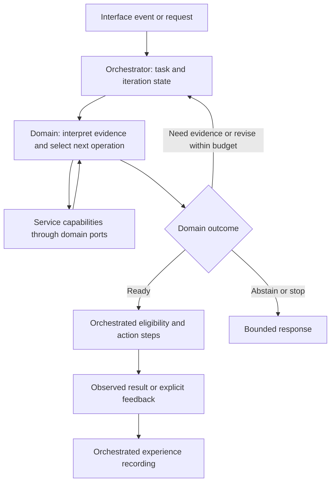

# Research: the Knowledge–Prediction–Experience feedback graph

Date: 2026-10-18. Status: research findings and proposed experiment; no final
ownership/topology decision. Tracking: [steps.json](../steps.json), step `02`.
Related proposal: [ADR 0005](./decisions/0005-knowledge-experience-content.md).

## Question and provisional conclusion

The user's concern is architectural: Knowledge, Prediction, and Experience can
depend on one another, producing a cycle before an action is ready. The earlier
assignment of Knowledge to general strategy and Experience to exact application
was accepted prematurely. It is now a hypothesis under research.

The literature supports interacting memory, representations, prediction, and
planning. It does not establish three standalone services, a fixed traversal
order, or guaranteed convergence. The engineering recommendation is to compare
bounded reasoning cycles with explicit state versions and termination conditions.
The semantic graph, computation dependencies, and action/learning cycle must be
distinguished before allocating responsibilities.

## Four graphs to distinguish

| Graph | Nodes and edges | Meaning of a cycle |
| --- | --- | --- |
| Semantic/data graph | Concepts, methods, episodes, predictions, typed relationships | Records may refer to or qualify one another |
| Model/inference graph | Variables, hypotheses, evidence, predictive relationships | Revising one belief can affect another |
| Runtime/workflow graph | Operations and conditional transitions | An operation may run again with revised input/state |
| Software dependency graph | Modules, ports, service clients, imports | Implementations or availability can become mutually dependent |

RDF's subject–predicate–object model illustrates stored relationships [R6]. It
does not prescribe execution. Dokja does not need a graph database merely to
express graph semantics. Cyclic workflow execution also does not require cyclic
package imports: dependencies can remain layered while task state evolves.

An arrow such as `Knowledge -> Prediction` needs a type and temporal meaning:
does it supply a model, retrieve evidence, revise a hypothesis, or wait for a
result? Treating all those relationships as synchronous calls creates ambiguity.

## Primary-source findings

| Source | Relevant finding | Engineering interpretation | Limit |
| --- | --- | --- | --- |
| Predictive map, 2017 [R1] | A model relates hippocampal representation to expected future states, reward and policy | Memory and prediction need not be independent stages | Does not prescribe service boundaries or universal confidence |
| Tolman–Eichenbaum Machine, 2020 [R2] | A model links reusable structural knowledge with sensory/contextual representations | General structure and specific instances can remain distinct while interacting | Does not equate recalled episodes with exact executable instructions |
| Dyna, 1990 [R3] | Learning and execution-time planning interact through real experience and a learned world model | Separate observed transitions from simulated planning branches | Does not validate imagined outcomes as observations |
| Active inference, 2017 [R4] | A process model links belief updates and action selection | Evidence seeking and uncertainty can affect the next operation | Requires a defined generative model; an API loop is not the theory |
| LangGraph official runtime [R5] | Cyclic execution uses state updates, explicit termination and bounds | A workflow can revisit operations without recursive service calls | Does not guarantee semantic convergence or justify framework adoption here |

These sources motivate reciprocal interaction. They do not establish a universal
hierarchy in which Knowledge always commands Experience or Experience always
selects the action. These software mappings are inferences to test.

Working definitions for the experiment:

- **Knowledge:** reusable facts, structural representations, concepts, general
  methods and constraints, with provenance and versions.
- **Experience:** observations of context, actions, outcomes and application
  details. Cases inform concrete application; applicability needs evaluation.
- **Prediction:** an explicitly targeted estimate conditional on available
  knowledge, experience, context and candidate action. Predicted next state,
  acceptance probability and retrieval similarity are distinct quantities.
- **Selection:** domain-owned evaluation of alternatives, missing premises,
  preconditions, and the next evidence/action request.
- **Orchestration:** scheduling registered operations, managing task versions,
  budgets, cancellation and execution boundaries.

## Two loops with different evidence

The inner loop prepares an action:

```text
goal + observed context
  -> retrieve knowledge and past experiences
  -> form candidate applications/actions
  -> predict consequences or evaluate uncertainty
  -> select: ready / need evidence / revise / abstain
  -> repeat with revised input if useful and within budget
```

Changing the proposed action can change which experiences are relevant. A
prediction can expose a missing premise and change which knowledge is retrieved.
That is a useful cycle; unchanged calls that add no evidence are not progress.
Evidence acquisition can still consume resources or have side effects, so the
workflow must classify it explicitly.

The outer loop learns from an observed result:

```text
ready proposal -> eligibility checks -> execute action
  -> observe actual outcome / explicit feedback
  -> record experience or unresolved attempt
  -> evaluate original prediction
  -> propose a knowledge/model revision for a later task
```

Simulated branches must retain hypothetical status and model provenance. Do not
insert a predicted success into the observed-experience corpus. Repeating a
model's self-confirmation does not supply independent evidence. A useful terminal
result can be abstention; missing outcomes remain unknown.

## Unroll the cycle over time

A circular-wait defect occurs when Knowledge waits for Prediction, Prediction
waits for Experience, and Experience waits for Knowledge to finish the same
uninitialized state. Instead, each operation consumes available versions and
returns a result for a later transition. Cold start may use explicit defaults,
an empty experience set, and an insufficient-evidence result.

One possible update schedule, not a universal scientific equation:

```text
S0 = goal, observations, allowed actions, available model/store versions
Kr = retrieve_knowledge(Sr)
Er = recall_experience(Sr, Kr)
Ar = propose_applications(Sr, Kr, Er)
Pr = predict_or_evaluate(Ar, Kr, Er, Sr)
Dr = select_next_step(Pr, Ar, Kr, Er, Sr)
S(r+1) = apply_validated_updates(Sr, Dr)
```

Other schedules can retrieve Knowledge and Experience in parallel or first
propose an action and then recall action-specific cases. Compare them. Every
result identifies the versions it consumed. Concurrent updates need defined
merge/conflict rules; “latest value wins” is not an inference algorithm.

The observed experience snapshot can remain frozen during inner reasoning while
the selected subset of recalled episodes changes. Bounded caching can avoid
identical calls, with invalidation on relevant input/model changes. Snapshotting
does not make remote models or observations deterministic by itself.

## Where the loop could live

| Option | Decision owner | Supervision | Assessment |
| --- | --- | --- | --- |
| A. Repeated domain steps | A domain returns typed decisions and evidence requests | Existing orchestrator manages each external step and workspace iteration | Closest to current workflow authority; needs richer transition contracts |
| B. Bounded domain-internal computation | One domain computes over supplied snapshots | Orchestrator supervises a larger operation; external evidence requests still return through orchestration | Can preserve a coherent cognitive macro-component; must expose cost, cancellation and trace |
| C. Services recursively call one another | Policy distributed across service implementations | Orchestrator sees only the eventual result | Conflicts with current cross-domain workflow rules and risks opaque circular waiting |

Compare A and B before accepting a topology. A is the provisional recommendation
because current orchestration already owns routing. It needs no new cognition
service. Pure bounded computation within a domain can support B. Neither gives
provider plugins ownership of cross-domain decisions.

Candidate control path for A:



The semantic graph can be reciprocal inside this control path. The orchestrator
executes registered operations and applies domain outcomes; it does not decide
domain truth. “Reason first, then let orchestration act” can describe the product
action boundary while orchestration supervises the reasoning work throughout.
If it means bypassing orchestration until services have negotiated a plan,
that requires an explicit change to the current architecture rules.

## Progress, stopping, and uncertainty

Candidate outcomes are `ready`, `need_evidence`, `revise`, `abstain`, `failed`,
and `budget_exhausted`. These refine the questions for ADR 0001; they are not
implemented public statuses. Each request identifies its missing premise,
operation, expected use of the result, and input/model versions.

Track a state signature over unresolved premises, evidence versions, candidate
action and model version. Repetition can expose stagnation; revisiting an older
signature can expose oscillation. Domain readiness requires actual preconditions,
not agreement between repeated model outputs.

Limits cover deadline, iterations, operations, evidence size and provider calls.
An iteration can contain several operations. ADR 0001's provisional limits must
not be misrepresented as a convergence guarantee. New evidence can increase
uncertainty or invalidate a candidate. Budget exhaustion means termination,
not that a fixed point was reached. Unavailable evidence and contrary evidence
remain different results.

## Current code and planning consequences

| Current code | Consequence |
| --- | --- |
| [Dispatcher](../dokja_orch/internal/core/dispatcher.go) runs a fixed list and aggregates by domain | Repeated domains need per-step/iteration records; the domain-keyed result map loses earlier iterations |
| [Workflow step](../dokja_orch/internal/core/workflow_engine.go) contains domain/action | Add explicit transition meaning and bounded state rather than recursive callbacks |
| [Memory prediction](../dokja_domain/dokja_memory/domain.go) recalls experiences before estimating acceptance | Already an Experience-to-Prediction dependency, but no general world-state simulator |
| [Predictor](../dokja_domain/dokja_memory/predict.go) uses action/context and a baseline | New predictive targets need explicit model/input/output contracts |
| [Knowledge store](../dokja_services/dokja_knowledge/store.py) stores documents/chunks/indexes | It is not currently an explicit concept/procedure graph; choose storage from actual query needs |
| [Hashtag experience](../dokja_orch/internal/handlers/hashtag_experience.go) records asynchronously using media refs | Does not establish durable pre-action, iteration-scoped prediction and feedback |

Book/Feeds is related but distinct: Book can specialize extraction and Feeds can
specialize source observation while reasoning uses normalized evidence. Existing
book classification and summary rules still require individual review; not
every book operation is parsing. Preserve the compatibility facade and current
deployments during research. Source modality can affect evidence without defining
a separate cognitive architecture for each source type.

## Experiment before accepting ADR 0005

Use deterministic fake capabilities and synthetic fixtures first. This research
does not adopt a framework, migrate schemas, or run the experiment.

| Scenario | Expected evidence |
| --- | --- |
| Knowledge exists, no experience | Supported default/knowledge-only proposal or explicit abstention; no circular wait |
| Experience changes candidate action | Trace records the changed candidate and supporting episode |
| Prediction exposes a missing premise | A distinct evidence request explains the next iteration |
| New evidence contradicts a plan | Revision or abstention; disagreement is not automatically execution failure |
| Simulation reports success | Outcome stays hypothetical and cannot become observed experience |
| State repeats or alternates | Defined stagnation/oscillation result within budget |
| Dependency fails or finishes late | Declared stop/degradation; terminal state rejects late mutation |
| Equivalent book/text/feed content | General reasoning reuse with different acquisition and provenance |
| Scope/model version differs | No workspace leakage; version and cache behavior are explicit |
| Product action is retried | Iteration does not itself repeat the side effect; receipt limits remain explicit |

Compare A and B on result quality, trace completeness, provider calls, latency,
cancellation and code coupling under fixed budgets. Record the existing single-pass
path separately. Longer explanations or higher self-reported confidence do not
establish improvement.

Before accepting ADR 0005, resolve the first task/prediction target, typed edge
meanings, update schedule, cycle owner, readiness/fallback rules, and the boundary
between observed experience and simulated branches. The earlier linear allocation
did not settle those choices.

## Sources and evidence scope

Primary papers and official documentation consulted on 2026-10-18. Bibliographic
identifiers replace external URLs to respect repository policy. Dokja mappings,
topology options and experiments are engineering inferences.

- **[R1]** Stachenfeld, Botvinick and Gershman (2017), *The hippocampus as a
  predictive map*. Nature Neuroscience 20, 1643–1653. DOI: `10.1038/nn.4650`.
  PMID: `28967910`. Original-paper abstract inspected; used for the predictive
  representation argument, not software implementation details.
- **[R2]** Whittington et al. (2020), *The Tolman-Eichenbaum Machine: Unifying
  Space and Relational Memory through Generalization in the Hippocampal Formation*.
  Cell 183(5), 1249–1263.e23. DOI: `10.1016/j.cell.2020.10.024`.
  PMID: `33181068`. Publisher/PubMed abstract inspected; institutional PDF
  exceeded the retrieval size limit. Used for structural/contextual interaction.
- **[R3]** Sutton (1990), *Integrated Architectures for Learning, Planning, and
  Reacting Based on Approximating Dynamic Programming*. ICML, 216–224.
  DOI: `10.1016/B978-1-55860-141-3.50030-4`. Original-paper abstract/proceedings
  record inspected through ML Anthology; linked PDF unavailable.
- **[R4]** Friston et al. (2017), *Active Inference: A Process Theory*.
  Neural Computation 29(1), 1–49. DOI: `10.1162/NECO_a_00912`.
  PMID: `27870614`. Original-paper abstract inspected. The formal model was
  not reproduced or evaluated for Dokja.
- **[R5]** LangChain, official LangGraph *Graph API overview*,
  `oss/python/langgraph/graph-api`. Execution, state, recursion-limit and
  re-execution sections inspected. An engineering example of bounded cyclic
  execution, not an adoption decision or benchmark.
- **[R6]** W3C (2014), *RDF 1.1 Concepts and Abstract Syntax*, sections 1.1
  and 3. Normative graph/triple model inspected; used to distinguish data
  relationships from execution dependencies.

No runtime implementation changed and no experiment ran for this research.
The research/decision package in step `02` can be completed with ADR 0005
explicitly deferred. Step `03` can gather baseline and reference-loop evidence
without accepting a production topology. Resolve the resulting decision before
step `04` integrates cognitive-loop contracts or any ownership migration.
