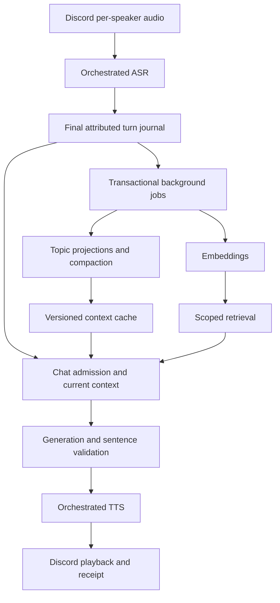

# Continuous realtime group conversation

Status: proposed implementation plan, 2026-10-28. No runtime changes or database
migrations are performed by this document. Baseline: the voice latency worktree
at `e315be4`. Targets below are release gates, not measured performance claims.

## 1. Outcome and binding product decisions

Ningo should follow a room continuously, understand who said what, remember what
the group is discussing, and respond promptly when participating. A conversation
must survive a topic detour and process restart without replaying its entire
history into the model.

1. Listen while people speak and while Ningo speaks. Preserve speaker attribution.
2. Answer when addressed; keep follow-ups open. The listener starter can continue
   without repeating Ningo's name. Evaluate spoken name variants with recordings.
3. Finish a spoken answer. Incoming speech, coughs, keyboard noise and backchannels
   must never cancel playback. Explicit stop and transport loss remain exceptions.
4. Speak one useful sentence early; ordinarily finish in two or three short
   sentences. Preserve the full chat persona, reasoning and conversational depth.
5. Keep topic state, decisions, corrections and open questions across turns.
   Compact model context without deleting its underlying evidence.
6. Reuse the existing PostgreSQL installation and pgvector capability. A new
   database server is not a prerequisite.
7. Choose a voice provider by measured Portuguese conversation quality and total
   latency. Do not assume a small local model or a CLI provider is inherently fast.

Realtime here means continuous perception plus bounded response delay. It does
not mean talking over people, answering every transcript, or promising zero delay.
Tool execution from speech is a separate feature: `/play` remains the established
music command until voice action authorization has its own reviewed contract.

## 2. Verified baseline and gaps

| Area | Current evidence | Required change |
| --- | --- | --- |
| PostgreSQL | `docker-compose.postgres.yml` supplies PostgreSQL 17 with pgvector; `dokja_services/dokja_knowledge/postgres_store.py` implements the Knowledge backend | Reuse infrastructure, provision a separately owned conversation schema; verify live server/extension versions before migration |
| Knowledge | `knowledge-postgres.md` describes `dokja_knowledge`, exact vector search and explicit backend selection | Do not turn room transcripts into Knowledge documents implicitly |
| Voice capture | Discord `voice/live_conversation.ts` keeps recognition ordering, bounded pending turns and uninterrupted playback | Separate continuous observation from response scheduling; avoid waiting for every speaker's ASR to finish forever |
| Context | `chat_domain_handler.go` passes a nil summarizer for voice; `chat_sessions` stores bounded SQLite snapshots | Add durable attributed turns and asynchronous, versioned compaction |
| Archive | `dokja_conversation` and `infrastructure/conversations` implement owner-only desktop/CLI archives in a separate SQLite file | Add explicit Discord scope policy; never bypass the existing owner-only archive checks |
| Eligibility | `voice_policy.go` owns engagement, starter continuity and backchannels | Preserve behavior; add auditable topic/addressing decisions and evaluation |
| Generation | Runtime is the default; optional local streaming exists; CLI final-response validation delays usable output | Benchmark actual usable speech latency; negotiate provider streaming capabilities |
| Persona | `voicePersona = chatPersona`, with voice presentation constraints | Preserve depth while bounding spoken output |
| Storage research | `dokja_store/spikes/cognitive_storage` evaluates storage/cognitive behavior | Reuse lessons and fixtures, not experimental tables as production storage |

The repository proves backend availability, not the current live database's
health, configured consumers or extension version. Capture these in phase R0
without printing credentials. Existing SQLite snapshots are not a full transcript
archive; missing historical turns cannot be reconstructed by migration.

Related plans: [conversation history](conversation-history-plan.md),
[Knowledge PostgreSQL](knowledge-postgres.md),
[cognitive storage](cognitive-storage-research.md), and
[capability ownership](capability-map.md). This plan extends group voice without
replacing the owner archive or declaring the broader cognitive migration complete.

## 3. Latency contract and measurements

Measure from the last human speech sample of an eligible utterance to the first
audible, substantive reply. Track the first outbound Discord audio frame as a
server-side proxy; validate actual audibility separately with loopback recordings.
Filler such as “let me think” does not satisfy the metric.

Initial warm, uncontended acceptance target: p50 <= 1.5 s and p95 <= 2.5 s.
Cold starts are reported separately. These are engineering targets requiring
provider qualification, not guarantees achievable by the present CLI path.

| Stage | Initial p95 engineering budget |
| --- | ---: |
| Endpoint decision after last speech sample | 350 ms |
| Remaining ASR finalization | 350 ms |
| Admission, durable append, context assembly | 150 ms |
| Generation to first usable sentence | 1,000 ms |
| First sentence synthesis | 300 ms |
| Playback enqueue and transport allowance | 200 ms |
| Unallocated margin | 150 ms |

The 2.5 s budget is an allocation, not a sum of independently measured percentiles.
Stages overlap; measure end-to-end percentiles directly. Report floor wait, older
reply playback, ASR queue wait and provider queue wait independently, and include
them in user-observed latency. Never discard congested turns from reports to make
the target pass. A continuously occupied room has no guaranteed audible start:
record deferred/superseded responses and maximum wait explicitly.

Instrument monotonic durations and a shared trace identity across capture,
endpoint, ASR enqueue/start/final, transcript commit, context ready, generation
start/first usable sentence/end, TTS start/first audio, playback start/end and
delivery receipt. Cross-process wall clocks alone are insufficient for short
intervals. Record scope hashes, turn IDs, revisions, provider/model provenance,
queue age, cancellation reason and resource pressure; omit transcript/audio data
from normal logs. Report errors, empty replies, noise admissions, wrong-speaker
answers and background-worker lag alongside latency.

## 4. Architecture and ownership

All external input follows Interface -> Event/Request -> Orchestrator -> Domain
-> Service. Persistence adapters implement domain ports; interfaces never call
ASR, model, embedding or PostgreSQL integrations directly.

| Owner | Responsibility and implementation location |
| --- | --- |
| Discord interface | Per-speaker capture, transport sequence, playback and receipts in `dokja_services/dokja_discord/voice/`; render status through existing command/channel surfaces |
| Communications domain | Audio request validation and playback transport contracts in `dokja_domain/dokja_communications` |
| Chat domain | Eligibility, topic transitions, context budget, compaction validation, response freshness and presentation in `dokja_domain/dokja_chat` |
| Conversation domain | Scoped session/turn lifecycle, idempotency, revision and retention contracts in `dokja_domain/dokja_conversation`; preserve owner archive restrictions |
| Orchestrator | Sequence perception, persistence, generation, delivery and background jobs; router/workflow/handler/client extension path |
| Persistence infrastructure | Proposed PostgreSQL adapter under `dokja_orch/internal/infrastructure/`; no domain policy in SQL clients |
| Stateless integrations | Voice perception/TTS, generation and embedding calls; no implicit conversation ownership in provider sessions |

Use an independently versioned `dokja_conversation` PostgreSQL schema, owned by
the conversation persistence adapter. Do not modify `dokja_knowledge` tables or
reuse its credentials as a permanent cross-domain database API. Share the server,
not unscoped table access. The orchestrator worker invokes domain policy and
stateless integrations; a new microservice is not required initially.

Two concurrent workflows share an ordered journal:



Capture/observation continues during generation and playback. A short room-scoped
transaction assigns journal sequence and updates state. No database lock remains
held across inference, TTS or audio playback. One playback owner per room uses a
lease/fencing generation; stale workers cannot publish after reconnect or restart.

## 5. Perception, ordering and response scheduling

Preserve independent Discord speaker streams. Add stable utterance IDs, capture
start/end times, speaker identity, segment index and revision. Overlapping human
speech remains overlapping evidence; sequence provides deterministic processing,
not a fabricated claim that people spoke one after another.

1. Evaluate endpointing against Portuguese pauses, hesitations and background
   noise. Test configurable 250–450 ms endpoint windows rather than simply lowering
   the current silence threshold. Reject noise before expensive recognition.
2. Benchmark the current tiny ASR against stronger candidates on identical audio.
   Include downmix/resampling quality and boundaries of long utterances. Use
   bounded overlap only with deduplication and provenance; never concatenate
   overlapping words blindly.
3. If supported, keep provisional transcripts for speculative context preparation.
   Only finalized revisions authorize spoken responses or durable decisions.
   A revision invalidates speculative generation before it becomes audible.
4. Replace the global “all recognition must finish” barrier with a bounded reorder
   window and explicit missing/failed segment markers. Start with a 750 ms
   reorder timeout, tune on fixtures, and retain late segments as late evidence.
   An unresolved segment belonging to the addressed question requires a brief
   clarification or a deferred answer, not confident guessing.
5. Publish finalized observations to the orchestrator independently of an active
   reply. Keep queues bounded by bytes, audio seconds and age, not only item count.
   Start with the existing 32-turn cap, a 10-second response freshness limit and
   explicit overflow markers. Do not silently drop context or replay stale replies.
6. Coalesce follow-ups into one response candidate while preserving each original
   turn. Admission is deterministic where possible; avoid a separate LLM call per
   utterance just to decide whether to answer.
7. Before first audio, recheck listener generation, authorization, turn revision
   and freshness. If the user corrected the question during generation, discard
   the unsaid response and answer the revised question. After playback starts,
   finish the answer and process new speech afterward, as requested.

Keep transcript state, engagement state and playback state separate. “Listening”
must not depend on being idle. A cough cannot indefinitely hold the floor. Long
silence, ASR timeout and a stalled provider each have their own terminal event.

## 6. Durable conversation and topic model

Proposed records, finalized in R1 before migrations:

| Record | Required fields and invariants |
| --- | --- |
| Session | Opaque ID, verified guild/voice-channel scope, listener generation, lifecycle, timestamps, revision; stable discussion identity distinct from a transient connection |
| Turn | ID, session/scope, capture ID, journal sequence, speaker, capture interval, final transcript revision, text, ASR provenance, uncertainty, outcome; unique scoped capture/revision key |
| Topic | ID, session/scope, title, status, participants, last relevant sequence, revision; title is a projection, not identity |
| Topic membership | Topic/turn references with reason and version; a turn can relate to several topics |
| Claim/decision/question | Kind, attributed author, proposed/confirmed/disputed/superseded status, source turn IDs, correction links; model summaries cannot confirm user decisions |
| Summary | Topic/session scope, covered-through sequence, source revision fingerprint, structured content, schema/prompt/model versions, validation result |
| Response | Trigger turns, context revision, generation attempt, selected/observed provider and model, generated sentences, playback receipts and terminal outcome |
| Embedding | Source artifact/revision, scope, model/version, dimension, vector, creation and invalidation state |
| Job/outbox | Scoped artifact key, job kind, revision, lease, attempts, next retry time and terminal failure |

Topic states: `in_progress`, `waiting`, `completed`, `abandoned`. Resumption is
an event returning a topic to `in_progress`, preserving previous completion and
its reason. Silence alone does not complete a discussion. Initial inactive topics
move to `waiting` after two minutes; this is scheduling policy, not evidence that
a question was resolved. Explicit completion or a supported resolved outcome can
close a topic. New evidence can reopen it.

Example: a group debates reading volume, pauses to request music, then says
“back to the books.” Music is a separate topic; the earlier discussion resumes
with attributed positions and its unresolved question. If one participant corrects
“ten books” to “two,” both utterances remain, but the current projection uses two.

Transactions append the turn and outbox jobs together. Projection writes compare
the expected source revision. Retries are idempotent; two workers cannot both
advance the same revision. Delivery distinguishes generated, queued, started,
finished, failed and unknown-after-disconnect. Unknown audio delivery is never
automatically replayed. Only speech actually delivered is described as something
Ningo has already told the room.

## 7. Compaction that preserves the conversation

Compaction is required for the intended experience. It runs asynchronously, never
as a prerequisite for the next answer. Its output is a replaceable projection of
evidence, not a new source of truth.

Initial prompt allocation: at most 6,000 input tokens or the selected provider's
smaller validated limit, with output reserve. Reserve up to 1,500 for persona and
instructions, 1,200 for topic state, 2,400 for recent turns, 600 for retrieved
evidence and 300 for current participant/delivery metadata. Measure the actual
persona size first; rebalance rather than truncate mandatory instructions. Include
the current question and its corrections before optional retrieval. Enforce both
token and transport byte/message limits.

Schedule incremental compaction after 12 new finalized turns or when recent
context reaches 70% of its allocation. Debounce for two seconds; cap to one job
per active topic and prioritize voice inference over compaction/embedding. These
are initial tunables, evaluated under load. Bound job input and output; a long
room cannot create an unbounded summarization request.

The structured summary contains topic, participants and attributed positions,
confirmed decisions, disputed claims, corrections, open questions, pending
actions and evidence references. It also records what is uncertain or missing.
An “action” here is a conversational record, not permission to execute a tool.

Validate schema, source IDs, scope, coverage sequence, sizes and revision before
publishing. Apply deterministic checks to decisions/corrections plus a labeled
semantic evaluation. Compare-and-swap publication rejects stale jobs. Keep the
last valid summary and recent uncovered turns if a worker fails. Rebuild from raw
turns periodically and after corrections affecting older evidence; do not create
an endless chain of summary-of-summary drift.

No eligible summary: use bounded recent turns with an explicit context-gap marker.
If a necessary earlier fact is missing, retrieve its source or acknowledge the
uncertainty. Never pretend a failed summary was successful or block speech while
waiting for it. Raw transcripts follow their own retention policy.

## 8. PostgreSQL and pgvector retrieval

The active topic, latest summary, pending questions and recent turns are direct
relational/cache reads. Embedding similarity is for recalling relevant earlier
topics, references and statements; it cannot determine truth, completion or who
has permission to access a conversation.

Start with exact vector search on bounded, authorized candidates plus lexical
search and recency/topic relevance. Index topic episodes and useful finalized
segments rather than every partial transcript or backchannel. Embed in the
background, tagged by source revision, embedding model and dimension. Never mix
incompatible embedding spaces. A changed source invalidates its old vector.

Fetch a small candidate set, deduplicate by source, hydrate authoritative current
revisions, then include at most four useful excerpts within the prompt budget.
Start with a 100 ms total retrieval deadline inside context assembly; fall back to
active context if embedding or retrieval is unavailable. Query embedding may use
a revision-bound speculative result; otherwise lexical retrieval can proceed
without blocking on a new model call.

All reads and joins include verified scope and retention/visibility filters.
Guild membership alone does not authorize another channel's transcript. Treat a
change in audience/access policy as a context invalidation boundary. Use a
least-privileged database role; test row security with the actual application
role if enabled, since table owners and privileged roles can bypass policies.

Consider HNSW only after exact search misses measured budgets. Compare filtered
recall against the exact baseline before accepting approximate search; filtering
can reduce returned candidates. Pin and record actual server/extension versions.
Do not infer production recall from the cognitive storage spike.

## 9. Generation, persona and speech delivery

Keep Runtime as the supported default until another path passes the same suite.
Provider candidates must support Portuguese conversation, the full persona,
speaker attribution, bounded context and cancellation before playback. Benchmark
warm/cold starts, concurrent ASR/TTS, long context and background jobs on the
actual hardware. Record p50/p95 first usable sentence, full answer, errors,
empty answers and human-rated coherence. Synthetic first-token speed is not enough.

Expose an explicit capability for committed, speakable output. CLI previews or
unvalidated structured output must not reach TTS. If a provider can only validate
at completion, report that limitation and its latency; do not label it realtime
streaming. A different backend may be necessary to meet R0's target.

Validate each complete sentence before scheduling TTS. Preserve sentence IDs and
deduplicate the final response against streamed sentences. Prefetch one sentence
while the previous sentence plays; bound buffered audio and generated text. Test
abbreviations, decimals, Portuguese punctuation and disconnects mid-sentence.
Once a sentence has been spoken, provider revisions cannot silently replace it.

Simple conversational replies use the qualified voice binding. Deep research and
tools remain explicit workflows; if they exceed the voice deadline, report the
pending work once and deliver a scoped result when ready. No automatic provider
switch halfway through an answer. A delayed result must still be relevant to the
room/topic and authorized audience before delivery.

## 10. Failure, retention and compatibility contracts

| Failure | Required observable behavior |
| --- | --- |
| PostgreSQL unavailable | Bounded in-memory continuity for the current room, explicit degraded persistence status; no claim of durable save or hidden writes into a different database |
| Compaction/embedding unavailable | Use last valid state plus recent turns; retry jobs with backoff and finite attempts |
| ASR low quality or missing segment | Preserve uncertainty; ask targeted clarification only when needed; never convert noise into a durable decision |
| Generation timeout/empty output | End the pending attempt visibly, allow next turn; no infinite room lock or automatic repeated speech |
| TTS/playback failure | Mark undelivered/partially delivered sentences; do not store the full generated answer as fully heard |
| Restart/hot reload | Fence old listeners/workers; restore context, mark unfinished attempts interrupted; never replay old audio automatically |
| Queue overflow | Record the gap and health event, bound memory; do not silently reorder or fabricate continuity |

Initial proposed retention: finalized transcripts and derived projections for
30 days, raw audio off by default, diagnostic recordings opt-in with short expiry.
Confirm operational retention before rollout. Durable user facts require their
own explicit memory policy; this plan does not promote room chatter automatically.
Deletion invalidates summaries, embeddings, caches and pending jobs by revision;
workers recheck tombstones before publication. Include backup expiry and restore
behavior so deleted content is not accidentally reintroduced into live context.

Compatibility review before implementation:

- Keep the shared event envelope unchanged. New metadata is optional and bounded
  inside existing payload/context fields with explicit version validation.
- Proposed additive operations cover observation, playback receipt and context
  status. Finalize domain action names, then route -> workflow -> handler -> client.
- Preserve existing `/voice_chat_start`, `/voice_chat_stop`, `/play`, text chat and
  owner archive behavior. Speech content does not acquire command authority.
- Introduce PostgreSQL conversation selection explicitly, default disabled until
  migration/canary. Configuration names are finalized in R1; update all affected
  compose files and `production-runbook.md` in the implementation batch.
- Add an independent schema version and refuse unsupported future versions.
  Do not bump the shared SQLite schema or migrate unrelated Memory/Knowledge data.
- Back up source snapshots, import only available scoped evidence with provenance,
  verify counts/hashes, and retain originals. Do not invent absent raw turns.
- After PostgreSQL receives new data, rollback disables new behavior while keeping
  the journal intact. Reverting to stale SQLite is not data-preserving rollback.

## 11. Delivery phases and exit criteria

Each phase is a cohesive reviewable implementation batch. Implementation remains
pending; this documentation does not mark any phase complete.

| Phase | Deliverable | Depends on | Exit evidence |
| --- | --- | --- | --- |
| R0 — baseline | Trace timeline, reproducible Portuguese audio fixtures, live infrastructure/provider inventory | None | End-to-end baseline with cold/warm distinction; dominant delay identified; no transcript logging |
| R1 — contracts | Domain state machines, scoped IDs, transport compatibility, schema and retention decision | R0 | Contract tests for ownership, duplicate IDs, corrections, topic resume and old clients; reviewed migration/rollback |
| R2 — continuous perception | Independent observation path, bounded reorder/queues, endpoint and ASR tuning | R1 | Overlapping speakers, delayed ASR, noise and speech during playback pass without cutting answers or permanent stalls |
| R3 — durable journal | PostgreSQL adapter, migrations, transactional outbox, leases, restart recovery | R1 | Concurrent append/idempotency tests, crash recovery, foreign-scope denial, backup/restore and failure tests |
| R4 — topic state and compaction | Revisioned projections, structured summaries, bounded context cache | R2, R3 | Long-session fixtures preserve corrections/open questions; failed/stale compactions cannot overwrite current state |
| R5 — selective recall | Background embeddings, scoped lexical/vector fusion, invalidation | R3, R4 | Recall/precision measured against labeled exact baseline; access/deletion/model-dimension tests pass within deadline |
| R6 — qualified voice output | Provider comparison, usable sentence streaming, delivery receipts | R0, R1, R2; integrate R4/R5 before final gate | Latency and persona gates pass under real shared-resource load; no duplicated/unsaid history |
| R7 — canary and hardening | One-room rollout, soak tests, dashboards, operational runbook | R2–R6 | User conversation test, fault injection, rollback rehearsal and target metrics recorded |

R2, R3 and provider benchmarking can progress independently after their contract
dependencies. Do not delay perception/latency fixes until semantic retrieval is
finished. Conversely, do not declare conversation continuity complete before
durable state and compaction pass their tests.

## 12. Verification and release gates

Build a consented or synthetic Portuguese corpus with clean speech, hesitations,
name variants, keyboard/cough/music noise, simultaneous speakers and corrections.
Keep exact transcripts and speaker labels outside public logs. Evaluate ASR word
error rate plus question-intent and attribution accuracy; a lower aggregate word
error rate alone is insufficient.

Required scenarios:

1. Starter talks after five minutes without naming Ningo; a bystander says “ok”;
   only the relevant exchange produces a reply.
2. Two speakers finish in one order and ASR finishes in another; later recognition
   cannot rewrite who asked the question. A hung ASR job eventually releases work.
3. Keyboard/cough noise during a reply neither cuts audio nor freezes the next
   turn. Speech during playback appears in the following context.
4. A correction arrives before audio starts: the unsaid answer is revised. The
   same correction during playback is handled afterward without cancellation.
5. A 45-minute conversation changes topics, returns to an earlier one and preserves
   decisions, disagreements and unresolved questions without unlimited prompt growth.
6. A stale compaction finishes after a correction or deletion; publication fails.
7. Two rooms discuss identical words; no summary, embedding or participant leaks.
8. Restart during journal append, generation and playback; no duplicate turn,
   duplicate audio or assertion that an unplayed sentence was heard.
9. Database, embedding, provider and TTS outages leave bounded queues and recover
   without requiring a manual listener reset for every transient failure.
10. Music `/play`, owner text chat and archived desktop/CLI conversations retain
    their existing behavior while voice runs under load.

Initial canary gates: at least 200 eligible warm replies across three sessions;
report p50/p95/p99 and all failures, with 1.5 s/2.5 s p50/p95 uncontended targets.
Run a 60-minute three-speaker soak plus a synthetic test at the configured speaker
cap. No automatic playback interruption, cross-scope disclosure, duplicate spoken
sentence or unrecovered queue stall is acceptable in fixtures. Target >=95%
correct attribution/intent on the labeled corpus, >=95% preservation of labeled
decisions/corrections/open questions, and <=1% false replies on noise/backchannel
clips. Report sample counts and disagreements; do not round a small test into a
production reliability claim. Human review must also accept persona and coherence.

Use existing module runners: `go test ./...` within changed Go modules,
`go test -race ./...` for concurrent Go paths, `pnpm test` in Discord, and pytest
for the voice service. Add PostgreSQL integration tests against a disposable
schema and record skipped external-service tests as skipped. Performance fixtures
and new commands are implemented and documented in R0, not invented here.

## 13. Rollout and immediate next action

First implement R0 observability and fixtures. In parallel with design work,
confirm the existing PostgreSQL consumer/version inventory without changing it.
Then freeze R1 scope and compatibility contracts before introducing storage.

Deploy incrementally: shadow journal -> shadow topic summaries -> active context
compaction -> selective recall -> qualified streaming path. Compare identical
fixtures and user sessions at each gate. Shadow work must have resource quotas
so it does not make the existing voice path slower. Enable one room first, keep
per-feature rollback switches, and retain PostgreSQL data on rollback. Development
hot reload remains useful for iteration; do not restart a listener mid-test and
interpret that interruption as provider latency. Production deployment requires
the existing approval process.

Technical references checked for this plan: pgvector upstream README sections
on exact/approximate search and filtering; PostgreSQL 17 manual section 5.9 on row
security. Record installed versions in R0. External URLs are omitted from this
repository document in accordance with repository publishing rules.

## R0 implementation evidence

The first instrumentation batch adds monotonic adapter timing events from capture
start through recognition queue/start, transcript readiness, response dispatch,
bridge request, eligibility, usable sentence/final reception and floor wait.
Events contain only a random trace ID, stage and elapsed milliseconds. The latest
contributing segment's trace follows the response and supplies the bridge message
identity. Other batched segments retain their own dispatch timings.

R0 remains in progress. Capture start is not the last speech sample; recognition
queue time includes endpointing. Handler completion includes awaited playback.
Stream parsing awaits speech callbacks, so final-frame reception can include
playback time. These events do not establish audible latency or pure provider
latency. Last-sample and outbound audio-frame timestamps, server-side correlation, a
reproducible corpus and a live baseline remain pending.

### TTS and player timing report

Voice replies now forward the trace through both streamed sentences and final
reply playback. Each synthesized segment gets an opaque sentence ID so prefetch
cannot mix timing pairs. Events cover `tts_requested`, `tts_ready`, `tts_failed`,
`playback_enqueued`, `playback_started`, `playback_finished`, and explicit playback
cancellation/start failure. Playback start means Discord's player reached Playing;
finish means the awaited player reached Idle. Neither proves remote audibility.

Run the offline report against a saved development log:

```sh
python3 scripts/voice_latency_report.py /tmp/voice-session.log
python3 -m unittest discover -s scripts -p test_voice_latency_report.py -v
```

The report contains sample counts, nearest-rank p50/p95/p99, incomplete trace
counts, malformed events and failure counts without echoing identifiers or log
contents. It measures recognition queue/work, dispatch wait, per-sentence TTS and
player time, plus a clearly labeled capture-to-first-player proxy. Recognition
work includes bridge and preprocessing overhead. Passive and batched segment
traces can legitimately have no playback; absence of playback is not alone a
failure. Separate cold/warm and workload recordings when collecting a baseline.
Zero samples produce null percentiles, never a claim of zero latency.

### Restored development baseline — 2026-10-28 local time

The development orchestrator, Discord adapter, voice service and Feeds service
were rebuilt and started with the instrumentation worktree mounted. The host
Runtime inference socket was restored. Discord reported ready; voice reported
Piper with the cached CPU Whisper model. Hot reload is active for the mounted
sources. These are development operations, not a production rollout.

Two sequential synthetic Portuguese requests through the authenticated voice
bridge completed in 8,705 ms and 9,456 ms, returning 54 and 53 characters.
They bypassed capture, ASR and playback and used isolated synthetic rooms. These
are bridge response measurements, not pure inference or end-of-speech latency.
Container restoration/build activity overlapped this diagnostic period; collect
an idle baseline before attributing the full delay to a provider. The current
path already misses the proposed latency gate in these samples.

Three local voice-service round trips using synthesized Portuguese audio measured:

| Sample | Piper synthesis | Whisper transcription |
| --- | ---: | ---: |
| 1 | 114 ms | 338 ms |
| 2 | 96 ms | 342 ms |
| 3 | 86 ms | 560 ms |

These synthetic audio measurements exclude Discord and human endpointing. They
establish neither ASR accuracy nor percentile reliability. No diagnostic audio
was played in Discord. A book-related bridge request initially failed at roughly
five seconds because Feeds was absent; Feeds was subsequently restored. Do not
classify that failure as model generation latency.

Fresh validation in the restored voice container passed all 12 tests via
`python -m unittest test_main test_speech_activity test_transformers_stt_service
test_voice_chat -q`, from the service directory. Live multi-speaker capture,
audible latency and the target corpus remain pending. The next measurement is a
user voice session with the new trace events, followed by provider-only timing
under an idle workload.

### Optional Knowledge timeout fix — 2026-10-28 local time

An additional idle bridge sample took 8,659 ms. Its logs showed an optional
Knowledge lookup consuming five seconds before generation. Knowledge was not
running. Direct Runtime requests with the full voice persona took 6,242, 4,456
and 3,981 ms; those prompts omitted bridge-specific attribution/identity notes,
so this is an isolation diagnostic rather than an identical-prompt benchmark.

Chat domain policy now bounds optional voice Knowledge retrieval to 100 ms.
Timeout continues without sources under the existing best-effort retrieval
contract; references returned within budget remain in context. Text chat retains
its existing retrieval budget. This adds no routes, envelopes, schemas or config.
It is not the planned semantic conversation-memory implementation.

Two synthetic bridge requests after hot reload took 3,738 and 3,851 ms, returning
65 and 60 characters. This is consistent with removing the five-second lookup
stall. Sample counts and variable response lengths prevent a percentile or
quality claim. The remaining delay still exceeds the realtime target. No Codex
model, reasoning configuration or final-response validation was changed. Official
Codex configuration documentation was consulted; tuning reasoning remains an
unapplied experiment rather than an assumed fix.

Regression tests exercise deadline expiry with continued generation and timely
reference inclusion. The full orchestrator suite, vet and the Chat domain suite pass with the
final domain policy constant and both regression tests.

### Repeated clarification investigation — 2026-10-28 local time

A live report of repeated acknowledgments/clarifications was traced to actual
model replies, not a hardcoded fallback. Read-only snapshot inspection found
short, broken recognized fragments and replies reporting missing context. There
was no known spoken reference for that test, so neither transcription accuracy
nor the relative contribution of segmentation/context can be quantified.

A controlled three-sentence Portuguese Piper corpus (37 reference words) compared
multilingual Whisper checkpoints with the existing preprocessing and decoding:

| Model | Word edit errors | Per-clip inference |
| --- | ---: | --- |
| tiny | 3 | 255–284 ms |
| base | 2 | 420–457 ms |
| small | 2 | 1,480–2,153 ms |

Punctuation/case/accents were normalized for word edit distance. All three had
two word edits on the sentence containing the assistant name. This is a small
synthetic diagnostic, not an ASR quality benchmark or proof of a name-recognition
fix. The development-only override selects cached base for a live trial, with
network-offline model loading preserved. Tracked defaults remain unchanged.
Small was not selected because its extra latency bought no gain on this fixture.
No transcript history was deleted and no generic response filter was introduced.
The follow-up test needs an exact known question spoken in the room; compare its
recognized meaning and speaker before claiming the clarification loop is fixed.

### Live dispatch delay and overlap correction

A short live window contained 38 capture traces, nine completed recognition/
dispatch pairs and two traces with playback. Recognition queue wait was negligible;
recognition median was about 427 ms, and some finalized segments waited as long
as 8,147 ms before dispatch. Median TTS preparation was about 97 ms. Two capture-
to-player observations ranged from roughly 6.0 to 13.6 seconds; they include the
human utterance duration and cannot establish end-of-speech latency or an SLO.

The report now strips Compose ANSI color wrappers before parsing timing JSON;
previously those wrappers caused every event in this log to be counted malformed.
A regression fixture covers colored output.

Response preparation no longer waits for all later captures and recognitions.
It still waits for earlier unfinished captures before the latest pending sequence,
keeps one response/playback owner, and waits for a quiet floor before first audio.
Later activity cannot erase an already scheduled finalized response. Speech never
cancels playback. This overlaps generation with later speech, without claiming
that any newly arriving correction is already included in the prepared answer;
those turns remain queued for the next exchange. Freshness/revision validation
from R1/R2 is still pending.

Regression tests cover preparation during later speech, quiet-floor playback,
later recognition not cancelling dispatch, earlier recognition preserving order,
and uninterrupted answers. Six targeted Discord test files and three offline
report tests pass. Hot reload restarts the Discord listener after source changes;
restart the listener command before comparing live behavior. Post-change live
latency has not yet been measured.
