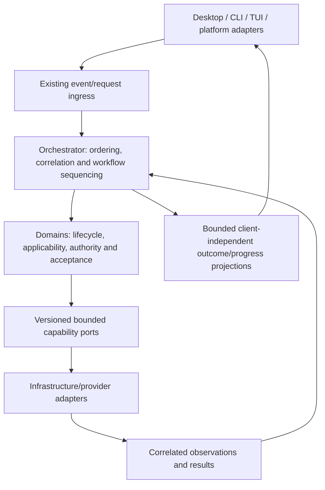

# Architecture follow-up: sessions, execution and coordination

Date: 2026-10-29. Owner correction: the [Cindy study](cindy-architecture-research.md)
must inform application architecture as well as interface design. The completed
CSS preparation remains useful, but it is not the central architectural adoption.
This source-based review adjusts planning; it changes no runtime contract.

## 1. Transferable patterns and current evidence

| Pattern from Cindy | Existing Ningo evidence | Architectural gap or next decision |
| --- | --- | --- |
| Product session independent of engine session | Conversation domain owns transcript/send identity, retry rules, scope and bounded context; runtime tests preserve the supplied transcript across model/provider switches | Connect durable conversation/send identity to workflow execution/attempt identity without adopting a provider's session as the application record |
| Explicit engine capabilities | Runtime has separate generation/streaming interfaces, measured-inference support and explicit provider registration/binding | Define required/optional operation contracts and unavailable/unsupported outcomes before dispatch; availability, configured selection and actual execution are different facts |
| Shared input coordination | Archive deduplicates sends; task runner enforces bounds and terminal state; desktop bridge distinguishes a missing route from an unknown interrupted stream | Define accepted, queued, dispatched and unknown outcomes, per-task ordering and concurrency between independent tasks; a transport timeout is not permission to resend |
| Normalized events | Task results carry statuses, reasons, step records, evidence and receipts; chat previews remain distinct from final replies | Establish bounded internal lifecycle/progress semantics with task/attempt/revision correlation, independently of a particular client or provider wire format |
| Explicit report settlement | Runner rejects late outcomes after cancellation/deadline and records unknown side effects; conversation store refuses invalid terminal updates | Define when execution has ended, a report has been delivered and its result has been accepted; old attempts must not complete a newer assignment |
| Team workers as independent sessions | Existing inference and typed workflows supply bounded building blocks; reliable general delegation is not established | Evaluate parent/child tasks only after lifecycle, authority and cumulative-budget contracts; do not require a team panel to prove backend behavior |
| Remote interfaces access a task owner | Desktop/CLI/TUI can use orchestrator-owned conversation operations; messaging has separate platform/scope semantics | Reuse application operations through authorized ingress; remote execution/relay infrastructure remains a separate requirement |

Source anchors:

- [Conversation domain](../dokja_domain/dokja_conversation/conversation.go):
  conversation/send/turn identity, explicit retry and archive/context separation.
- [Task contracts](../dokja_orch/internal/core/task.go) and
  [runner](../dokja_orch/internal/core/task_runner.go): one bounded volatile
  execution attempt, fresh `TaskID` and `AttemptID` on each `RunTask` invocation,
  terminal guards and late-result handling. This is existing behavior, not a bug
  finding or permission to change those IDs in place.
- [Inference contract](../dokja_domain/dokja_inference/contract.go): version,
  task/revision, authorized evidence, proposed actions and remaining calls. Its
  simulation experience contract is not a universal production episode model.
- [Runtime generation contract](../dokja_domain/dokja_runtime/chat.go) and
  [switching tests](../dokja_domain/dokja_runtime/chat_test.go): explicit binding,
  optional streaming and transcript preservation. Tests were inspected here,
  not rerun by this documentation batch.
- [Desktop stream adapter](../dokja_interfaces/desktop/src/main/chat_stream.ts):
  provisional previews, final response, bounded input and conservative fallback.

## 2. Target relationship to validate

This is a proposed contract relationship within the mandatory layer flow, not a
new deployment topology. Logical conversation, send, task, attempt, provider run
and state revision must each have an explicit meaning. Do not collapse them into
one ID or create another parallel transcript/task database by default.

Domain policy decides eligibility, applicability and result acceptance.
Orchestration serializes relevant transitions and enforces aggregate bounds.
Provider services execute capabilities and report observations. Interfaces render
and submit operations; neither the desktop nor an agent SDK owns application
truth or cross-domain workflow policy.

## 3. Backend work before interface expansion

New step `10.6` defines the foundation in independently verifiable batches:

1. **Identity and lifecycle contract.** Relate existing conversation/send and
   task/attempt identities. Specify retry, terminal, revision and unknown-outcome
   semantics using existing ports. Define compatibility before implementation;
   do not replace the public event envelope or existing runner contract implicitly.
2. **Input dispatch and capability admission.** Define bounded per-task ordering,
   accepted/queued/dispatched receipts, independent-task concurrency, cancellation
   and unsupported operations. A caller cannot invent capabilities or authority.
   Queue acceptance does not establish provider execution or external effects.
3. **Result settlement and recovery.** Bind results/reports to their attempt and
   current revision; reject stale/duplicate/foreign outcomes. Separate report
   delivery from accepted completion. Review durable state and recovery needs
   before choosing storage or schema; never replay an unknown side effect merely
   because an executor or connection restarted.

Use deterministic adapters and application-port tests first. Required cases
include duplicate sends, concurrent inputs, delayed old results, partial failure,
unsupported capabilities, cancellation, exhausted cumulative budgets and restart
with unknown outcomes. Add persistence only for a demonstrated recovery contract.

Provider-specific translation remains in infrastructure. Normalized events may
express execution observations, but cannot make a provider proposal authoritative
or convert retry/status heartbeats into proof of progress. Existing bounded
inference remains bounded; full tool-using engine execution would require an
explicit extension of [ADR 0011](decisions/0011-inference-provider-boundaries.md).

## 4. Dependency correction

- Backend step `10` follows cognitive evaluation `08`, independently of completion
  of the interface additions under `09`. Concrete cross-layer needs must use
  explicit dependencies instead of making all backend work await the entire UI.
- `10.6` supplies lifecycle/dispatch/settlement contracts.
- `10.5` delegation depends on `10.3` inference integration and `10.6`, replacing
  its prior dependency on UI step `09.8`.
- `09.8` consumes `10.6` alongside conversation history and component foundations.
  It does not invent the lifecycle for the backend to implement afterward.
- Final deployment review `11` waits for both application adoption `09` and backend
  work `10`, preserving the migration-completion requirement.

The active `08.2` vertical and `08.3` causal/reliability controls remain unchanged.
Compatible token preparation does not replace them. After that gate, prioritize
the `10.6` foundation and `10.3` integration over further component polish, then
evaluate delegation with a real workload and a single-task baseline.

## 5. Scope limits

No new central service, database, broker, remote relay, mobile app, plugin engine
or autonomous provider control is approved by this review. Cindy's desktop host
placement and lead-agent authority cannot be copied into Ningo without violating
its current boundaries. Durable transcript, bounded model context, working state,
knowledge and observed experience remain different records.

This batch verifies source references and roadmap consistency. It does not prove
new scheduling, durable execution, cross-provider parity, delegated-task quality
or application learning. Those require the planned contracts and experiments.
